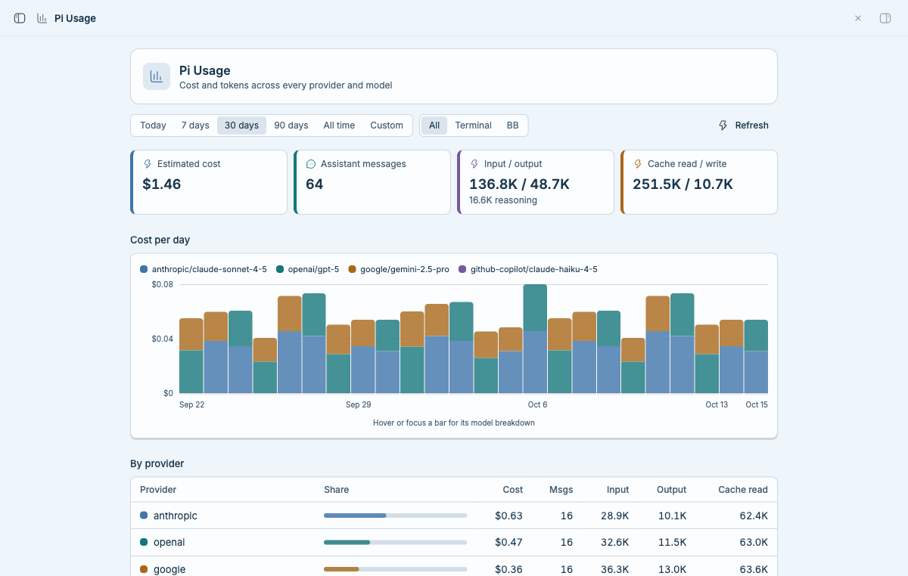
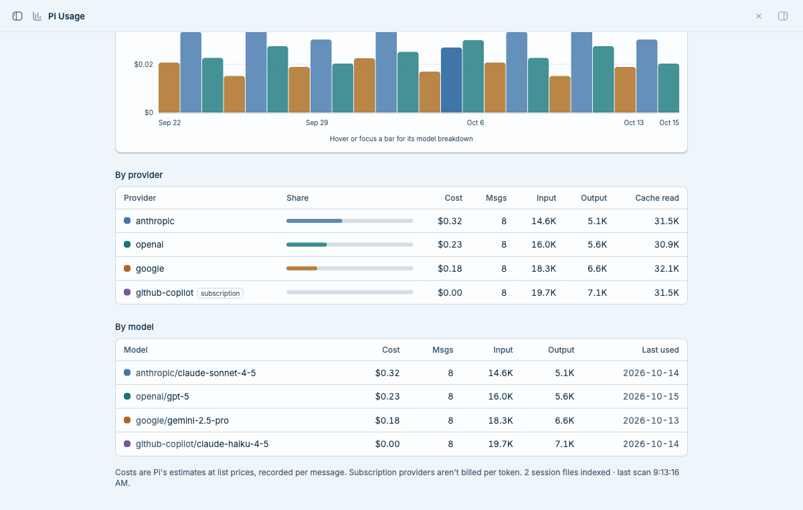
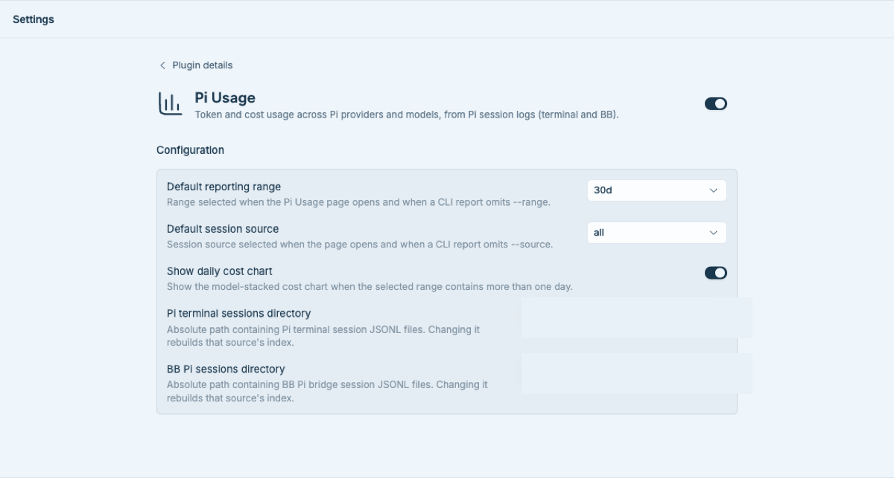

# Pi Usage

Pi Usage turns the usage metadata already recorded in local Pi session logs into a
single report in BB. It indexes assistant-message token counts and Pi's recorded
cost estimates, then groups them by day, provider, model, and session source
(Pi terminal or BB). If you do not use Pi, or have no readable Pi session logs,
the plugin has no usage data to report.

The cost figures are **estimates recorded by Pi at list prices**, not invoices.
OAuth/subscription providers such as `openai-codex` and `github-copilot` are not
billed per token even though Pi records an estimated cost for their messages.

## Prerequisites

- BB 0.45 or newer with Plugin SDK 0.6.15 or newer.
- Pi session JSONL files in the default locations, or an absolute path to each
  custom session directory.
- Node.js and npm only when developing or installing from source.

No provider credentials are required. The plugin reads usage from existing
session logs; it does not contact model providers.

## Installation

Install the latest compatible 0.1 release from GitHub:

```sh
bb plugin install 'git:https://github.com/jgarrow-springhealth/bb-plugin-pi-usage.git@^0.1.0'
``` For local
development, from this repository run:

```sh
npm install
bb plugin install .
```

## Open and use Pi Usage

Open **Pi Usage** from BB's sidebar. The page initially shows the configured
reporting range and source. Use the range and source controls to inspect a
different view, choose **Custom** for an inclusive date window, or choose
**Refresh** to rescan immediately. Reports include totals, a daily model-stacked
cost chart, provider and model breakdowns, and the number of indexed files.

The same index is available from the CLI:

```sh
bb pi-usage summary
bb pi-usage models --range 7d --limit 10
bb pi-usage daily --source bb
bb pi-usage summary --range custom --from 2026-01-01 --to 2026-01-31 --json
bb pi-usage refresh
```

Reporting commands accept `--range today|7d|30d|90d|all|custom`,
`--source all|terminal|bb`, and `--json`. A custom range also requires `--from`
and `--to` in `YYYY-MM-DD` order. CLI flags override configured defaults.

## Configuration

Open **Settings → Plugins → Pi Usage**. BB validates and persists these settings:

| Setting | Default | Effect |
| --- | --- | --- |
| Default reporting range | `30d` | Initial page range and CLI range when `--range` is omitted. |
| Default session source | `all` | Initial page source and CLI source when `--source` is omitted. |
| Show daily cost chart | On | Shows the chart for ranges containing more than one day. |
| Pi terminal sessions directory | `~/.pi/agent/sessions` | Absolute directory scanned for terminal Pi session JSONL files. |
| BB Pi sessions directory | `~/.bb/pi-bridge-sessions` | Absolute directory scanned for BB Pi bridge session JSONL files. |

Changing a session directory clears and rebuilds that source's derived index
and immediately refreshes an open report, including when the new directory is
empty or missing. It does not modify session files. To restore a setting to its
declared default through BB's supported CLI, run:

```sh
bb plugin config pi-usage unset <setting-key>
```

Setting keys are `defaultRange`, `defaultSource`, `showDailyChart`,
`terminalSessionsDir`, and `bbSessionsDir`.

## Data access and storage

- **Local file access:** recursively reads `.jsonl` files beneath the two
  configured session directories.
- **Plugin storage:** stores a derived incremental index in BB's plugin-scoped
  SQLite database.
- **Network/external services:** none.
- **Credentials/secrets:** none. The plugin neither requests nor displays API
  keys. Session logs may contain conversation content, but the index stores only
  path/source, day, provider, model, token counters, message count, and Pi's
  recorded total-cost value.

The indexer scans when needed, on manual refresh, and approximately every five
minutes while the plugin is running.

## Development

```sh
npm install
npm run typecheck
npm test
npm run build
```

`npm run build` runs `bb plugin build` and writes the distributable plugin
artifacts to `dist/`. During development, `bb plugin dev` can rebuild and reload
on changes.

## Screenshots

A synthetic 30-day report exercises the real summary cards and daily chart:



The lower report shows provider and model breakdowns, including subscription
providers that do not have per-token billing:



The native BB settings page exposes report defaults and session-source paths.
Local path pixels are replaced with opaque redaction, and the capture excludes
the unrelated installed-plugin list:



## License

MIT © 2026 Janessa Garrow. See [LICENSE](LICENSE).
